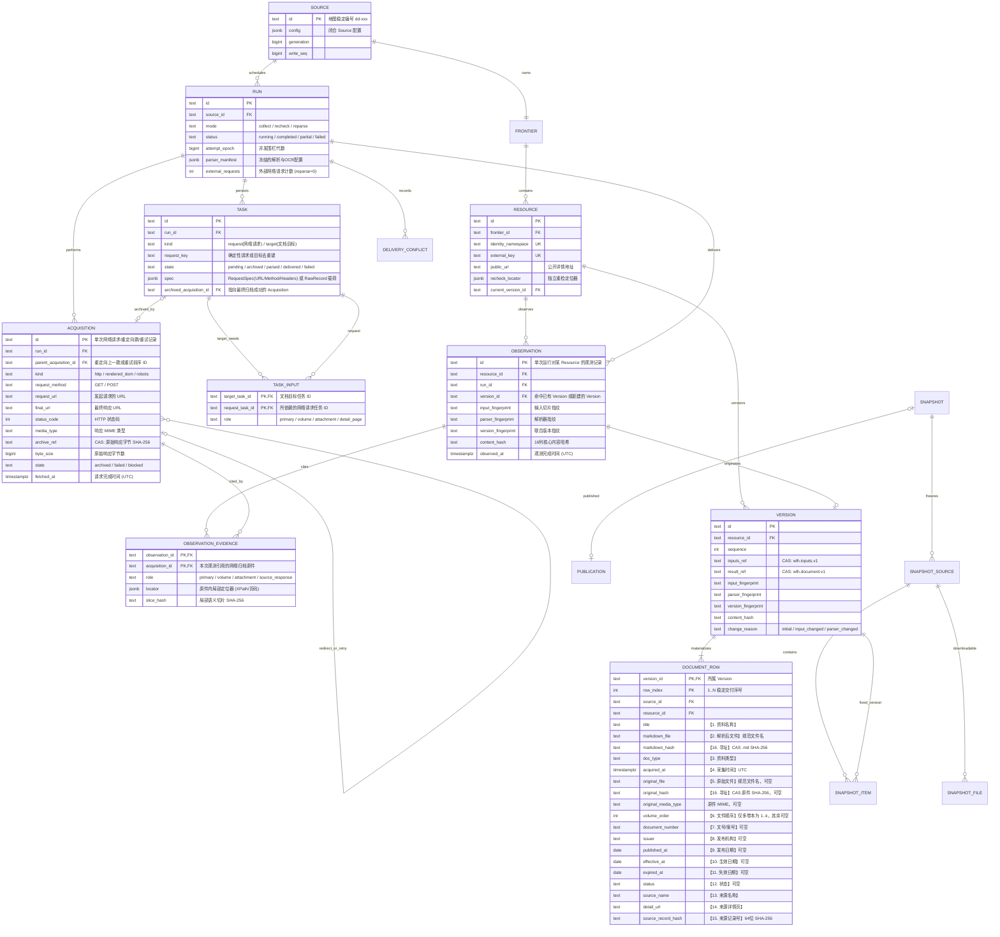

# 16 列核心采集模型与可插拔投影架构 (Core 16-Column Model & Projectors)

> 本文档是 [全局架构现状](overview.md) 的数据专题展开，定义 `WorldLawHarvester` (`wlh`) 第一版聚焦采集落地的极简核心文档合同（`wlh.document.v1`）、PostgreSQL 关系数据库模型（`wlh.document_row`）以及可插拔下游投影器（Projector）机制。

## 1. 设计原则：极简核心字段 + 保留可插拔投影层

为了避免过度设计，`WorldLawHarvester` 采集层严格遵守以下原则（详见 [ADR-0001](../adr/0001-canonical-legal-domain-and-pluggable-projectors.md)）：
1. **采集层只负责把数据抓下来，第一版只收集 16 列所需字段**：不做复杂的法学本体论设计（不搞跨国法律位阶、不搞法条语法树 AST、不搞上位法/立改废引用抽取、不搞复杂的判例合议庭/当事人拆解）。
2. **核心层用干净的英文标准字段存储，投影层负责格式转换**：
   - **核心存储层（`wlh.document.v1` & `wlh.document_row` 表）**：用直观的英文列名存储与 16 列一一对应的基础字段。
   - **可插拔投影层（`src/wlh/projections/`）**：保留 `Projector` 插件机制。默认通过 `template_16col.py` 将核心表字段投影为 [法规案例元数据上传模板](../reference/法规案例元数据上传模板.xlsx) 的 16 列中文表格格式；未来若需对接其他系统格式，只需新增一个轻量投影器函数，无需改动爬虫或数据库表。

---

## 2. 数据库关系模型 ER 图（`wlh` Schema）

将原先繁琐的双表拆解直接拍平为单张干净的交付行表 **`DOCUMENT_ROW`**（每个可交付的主文档、分卷或独立附件对应一行，直接与 16 列模板字段一一对应）：



---

## 3. 极简核心字段与 16 列投影严格对齐表

所有原生 Adapter 与五大开源 Bridge 产出的 `RawRecord`，落库到 `DOCUMENT_ROW`（及 S3 CAS 中的 `wlh.document.v1`）后，与 `template_16col` 投影器的对应关系如下（**零多余字段**）：

| 序号 | 16 列模板中文字段名 (`template_16col`) | 核心表英文字段名 (`DOCUMENT_ROW` / `RawRecord`) | 类型与规则说明 |
| :---: | :--- | :--- | :--- |
| 1 | `资料名称` | `title` | 非空字符串（NFC 归一化标题） |
| 2 | `解析后文件` | `markdown_file` | `{safe_title}_{markdown_hash[:8]}[_{volume_order:02d}].md` |
| 3 | `资料类型` | `doc_type` | `法律法规` / `政策文件` / `案例` / `行业标准` / `通知公告` / `财务报告` / `会计准则` / `税务资料` / `其他` |
| 4 | `采集时间` | `acquired_at` | 权威采集时间，投影格式化为 UTC `YYYY-MM-DD HH:MM:SS` |
| 5 | `原始文件` | `original_file` | 原件规范文件名（如 PDF/DOCX）；仅网页正文无独立附件时为 `null` |
| 6 | `文件顺序` | `volume_order` | 仅多卷本（分卷附件）为 `1, 2, ...`，其余为 `null` |
| 7 | `文号/案号` | `document_number` | 官方发文字号或法院案号，可空字符串 |
| 8 | `发布机构` | `issuer` | 发文机关或审理法院名称字符串（多机构以 `"; "` 拼接），可空 |
| 9 | `发布日期` | `published_at` | `YYYY-MM-DD` 或 `null` |
| 10 | `生效日期` | `effective_at` | `YYYY-MM-DD` 或 `null` |
| 11 | `失效日期` | `expired_at` | `YYYY-MM-DD` 或 `null` |
| 12 | `状态` | `status` | 如 `现行有效`、`尚未生效`、`已修改`、`已废止`、`已失效` 或源站状态文本，可空 |
| 13 | `来源名称` | `source_name` | 官方来源名称（默认从 Source YAML `metadata.source_name` 继承） |
| 14 | `来源详情页` | `detail_url` | 公开详情页 URL |
| 15 | `来源记录号` | `source_record_hash` | 由 `(source_id, namespace, external_key)` 计算的 64 位小写 hex SHA-256 |
| 16 | 附加文件寻址字段 | `original_hash`, `markdown_hash`, `source_id`, `resource_id`, `version_id`, `row_index` | 供客户端通过 `GET /files/{sha256}` 下载原件与 `.md` |

---

## 4. 四重确定性指纹合同

为确保列表翻页变化、站点外围 DOM 噪音或重放采集不会制造虚假版本，`Version` 通过以下四个 SHA-256 指纹判定变更：

1. **`input_fingerprint`**：基于 `wlh.inputs.v1` 中每个输入的 `(role, semantic_locator, slice_hash, charset, volume_order)` 计算。
2. **`parser_fingerprint`**：基于冻结的 `parser_manifest`（Adapter 选项、Office/PDF 提取策略、OCR 模型与质量门禁阈值）计算。
3. **`version_fingerprint`**：`digest(input_fingerprint + parser_fingerprint)`。
4. **`content_hash`**：基于 `wlh.document.v1` 的 16 列核心业务载荷（元数据、日期、`markdown_hash` 与 `original_hash`）计算。

---

## 5. 可插拔下游投影器架构（`src/wlh/projections/`）

所有下游导出视图实现统一的轻量 `Projector` 协议：

```python
Projector.project(row: DocumentRow) -> dict[str, Any]
```

- **`template_16col`（默认投影器，`GET /results`）**：将 `DocumentRow` 的英文标准字段直接映射为上述 16 列中文键名返回。
- **`canonical`（英文直出投影器，`GET /results?projection=canonical`）**：直接按 `DocumentRow` 的英文标准键名返回 JSON。
