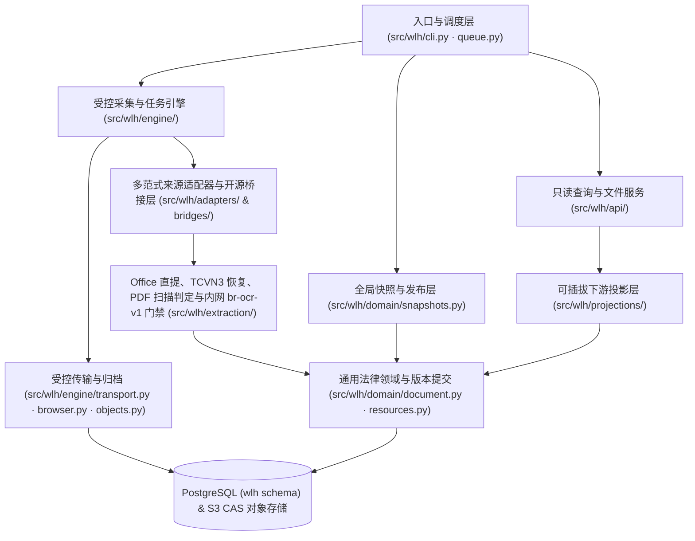
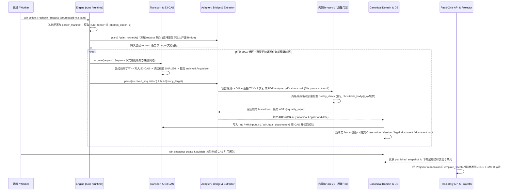

# 全局架构现状 (Architecture Overview)

> 本文件仅维护全局主干（两张 Mermaid 图 + 一组核心约束）。通用法律文档领域模型、关系表 ER 图与可插拔投影器设计详见专题文档 [通用法律模型与投影架构](canonical-legal-model.md)，首批实施规划见 [Issue #1 首批架构与分阶段实施计划](../spec/issue#1/spec.md)。

## 1. 模块边界与源码地图

- **入口与调度层（`src/wlh/cli.py`、`src/wlh/engine/queue.py`）**：负责解析 CLI 命令（`init`、`collect`、`recheck`、`reparse`、`worker`、`snapshot`、`serve`）、加载并校验 `sources/dd-xxx.yaml` 配置，不直接处理采集细节或文档解析。
- **受控采集与任务引擎（`src/wlh/engine/`）**：管理 `Run` 生命周期、PostgreSQL advisory lock、`attempt_epoch` 围栏、持久任务 DAG（`request` 任务与 `target` 文档目标）以及受控外部获取（基于 `httpx`/`aiohttp` 的 HTTP 传输与基于 `playwright` CDP `Fetch.requestPaused` 的 `rendered_dom`）和 S3 CAS 归档核验（彻底弃用 `crawl4ai`，见 [ADR-0003](../adr/0003-multi-adapter-bridges-and-intranet-ocr-stack.md)）。
- **多范式来源适配器与开源桥接层（`src/wlh/adapters/` & `src/wlh/adapters/bridges/`）**：除原生适配器（`web`、`vietnam_law`、`federal_register`、`structured_xml`）外，原生提供五大开源法律采集桥接器（`JuriscraperBridge`、`OldpProviderBridge`、`OpenStatesBridge`、`OpenCaseLawBridge`、`WorldWideLawBridge`），通过受控会话代理（`CasSessionProxy`）将所有脚本请求统一拦截归档至 S3 CAS，并将上游抽取结果统一收敛为仅包含 **16 列所需字段**的极简候选结构 `RawRecord`（含 `1..N` 个 `RawUnitSource`）。
- **文档提取、内网 `br-ocr-v1` 与质量门禁（`src/wlh/extraction/`）**：重构并内化 [office_text_extract.py](../reference/office_text_extract.py) 与 [production_document_parse.py](../reference/production_document_parse.py)，在受控子进程组中完成容器魔数识别、Office 结构化直提、`.doc -> txt:Text -> TCVN3` 历史字体逐行恢复、基于 `PyMuPDF` (`fitz`) 的 PDF 逐页墨迹比（`ink_ratio`）扫描判定、内网 `br-ocr-v1` 版面 OCR 服务调用（`/file_parse` -> `/status/{uuid}` -> `/result/{uuid}`，支持 S3 CAS 派生 OCR JSON 缓存与本地 `tesseract` 备选）与按语种参数化的客观质量门禁（`quality_check`）。
- **16 列核心领域与版本提交（`src/wlh/domain/`）**：构建并校验 `wlh.inputs.v1` 与 `wlh.document.v1` CAS 对象，计算四重确定性指纹（`input_fingerprint`、`parser_fingerprint`、`version_fingerprint`、`content_hash`），并在短事务内原子提交 `Observation`、`Version` 与 `document_row`；同时支持全局 `Snapshot` 一致性封存与发布切换。
- **可插拔下游投影与只读 API（`src/wlh/projections/`、`src/wlh/api/`）**：基于已发布 `Snapshot` 对外提供按指定投影器（默认 `template_16col` 对齐 16 列中文模板，可选 `canonical` 英文直出）转换的结果查询（`GET /results`）以及基于 SHA-256 闭包鉴权的原件/Markdown 下载（`GET /files/{sha256}`）。

## 2. 核心执行链路与数据流

- **核心数据合同（定义详见 [16 列核心采集模型与可插拔投影架构](canonical-legal-model.md)）**：
  - `RawRecord`（及 `RawUnitSource`）：所有原生 Adapter 与五大开源生态 Bridge 的唯一统一上游输出数据结构（严格对齐 16 列所需字段）。
  - `wlh.inputs.v1`：文档输入血缘清单（绑定 `acquisition_id`、`archive_ref`、角色 `role`、精确 `locator` / `semantic_locator` 与局部切片哈希 `slice_hash`）。
  - `wlh.document.v1`：16 列对应的核心文档对象（落库至 `wlh.document_row`）。
  - `Projector` 协议：将 `wlh.document_row` 确定性映射为下游目标 Schema（如对齐 [法规案例元数据上传模板](../reference/法规案例元数据上传模板.xlsx) 的 `template_16col` 投影）。

## 3. 系统不变量与边界约束

- **先归档、后解析不变量**：无论使用原生 Adapter 还是桥接开源脚本（`Juriscraper`、`World Wide Law` 等），任何未在 `wlh.acquisition` 表中处于 `archived` 状态且未完成 S3 CAS SHA-256 读回核验的字节，严禁进入解析或提取阶段（见 [ADR-0002](../adr/0002-controlled-cas-acquisition-and-offline-reparse.md)、[ADR-0003](../adr/0003-multi-adapter-bridges-and-intranet-ocr-stack.md)）。
- **零外部来源网络重解析不变量**：在 `mode = 'reparse'` 下，传输层硬性阻断一切针对外部来源站点的 HTTP/浏览器请求（`external_requests = 0`），仅允许从已归档 CAS 对象读取原件并调用本地提取器或内网 `br-ocr-v1` 解析服务重建版本。
- **Attempt Fencing 与短事务不变量**：外部网络获取、浏览器渲染、LibreOffice 转换与内网 `br-ocr-v1` 轮询期间严禁持有数据库事务；所有任务推进、Acquisition 状态变更与 Version 提交必须校验当前 `run.attempt_epoch` 与 `source.generation`。
- **三阶段完成点分离不变量**：`原文已归档（request task archived） ≠ 文档目标已登记（target row exists） ≠ 文档目标已交付（Observation/Version committed）`；中途崩溃恢复时从已归档原件确定性补齐未交付目标。
- **领域核心与下游投影隔离不变量**：核心数据库表与 `wlh.legal_document.v1` 严禁耦合特定下游表格列名；所有下游定制格式统一在 `src/wlh/projections/` 中以无副作用的纯函数投影器实现（见 [ADR-0001](../adr/0001-canonical-legal-domain-and-pluggable-projectors.md)）。
- **全局快照闭包与不可变性**：`wlh.snapshot` 封存（`sealed = true`）与发布（`publish`）前必须读回核验所含全部 `wlh.legal_document.v1`、`wlh.inputs.v1`、原件及 Markdown 的 S3 CAS SHA-256；封存后映射由数据库触发器强制不可变。
